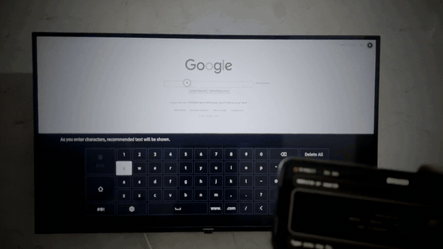
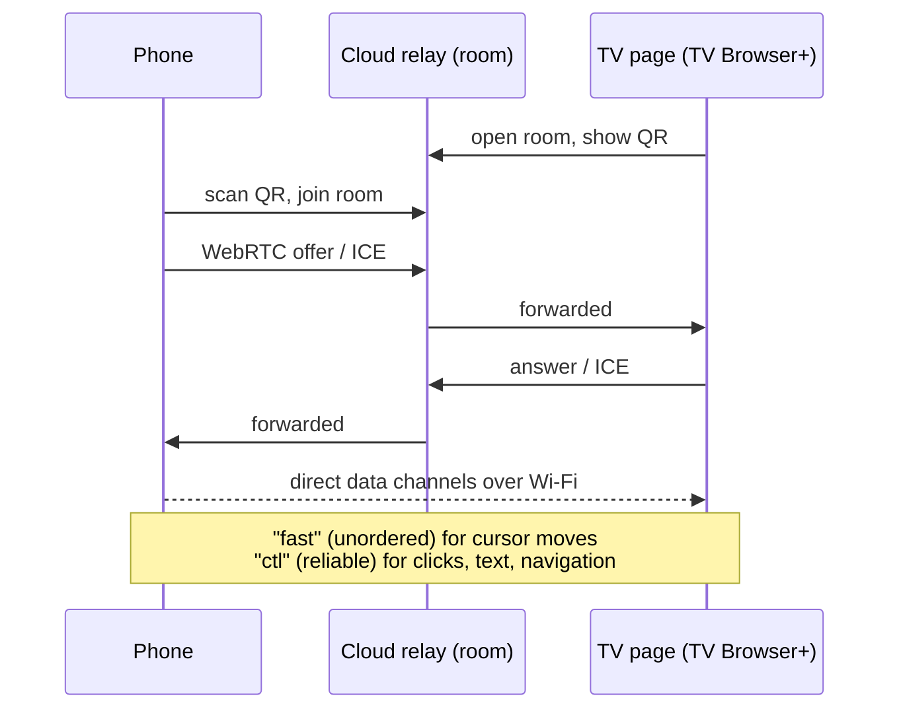

<div align="center">

# TV Browser+

**Make any website usable on a Samsung TV.** A remote-driven cursor, link-jump mode, per-site text size, and your phone as a touchpad and keyboard.


**[How it was built →](https://tv-hack.pvhome.workers.dev/log/tv-browser)** &nbsp;·&nbsp; [DotOS](https://github.com/prutxvi/samsung-tv-dotos)



</div>

> Part of **[DotOS for Samsung TVs](https://github.com/prutxvi/samsung-tv-dotos)**, built by [prutxvi](https://github.com/prutxvi) with Claude.

## Install

1. Install [TizenBrew](https://github.com/reisxd/TizenBrew) on your TV.
2. Open **TizenBrew → Module Manager** and add:
   ```
   gh/prutxvi/tv-browser-plus
   ```
3. Launch **TV Browser+** from TizenBrew. The start page opens with bookmarks and a QR code for your phone.

## Controls

| Remote | Action |
|---|---|
| **Arrows** | Move the cursor (it accelerates when held) |
| **OK** | Click |
| **CH ▲ / CH ▼** | Scroll |
| **Back** | Go back |
| 🟡 **Yellow** | **Jump mode**: arrows hop between links and buttons with a red highlight; OK opens |
| 🔴 **Red** | Cursor on / off |
| 🟢 **Green** | Start page |

<table>
<tr>
<td width="34%"></td>
<td>

### Phone pad

Scan the QR code on the start page and your phone becomes:

- a **touchpad**: drag to move, tap to click, two fingers to scroll
- a **URL / search bar** and a **keyboard** for typing into the TV
- **Back · ⌫ · Enter · Start** buttons
- **Text size** (A− / 100% / A+), remembered per site

The meter at the top shows the live delay: **Direct · N ms** when the phone and TV are talking directly over Wi-Fi, or **Internet · N ms** on the fallback relay.

</td>
</tr>
</table>

## How it works



- **Why not talk to the TV directly from the start?** Websites are `https`, and browsers block secure pages from reaching the TV's local `http` server (mixed content). The relay only introduces the two sides; after that, traffic goes peer-to-peer.
- If a direct link can't form, everything keeps working through the relay.
- The pairing follows you from site to site, so you scan the QR once.
- The cursor sits on its own GPU layer and redraws at most once per frame; phone moves are batched every 20 ms.

## Known limitations

- **Google sign-in** refuses the TV's built-in browser engine. This module doesn't try to work around that.
- Some sites ignore clicks and keys created by scripts ("untrusted" events), and sites with a strict Content-Security-Policy (e.g. Reddit) block the phone connection. The remote cursor still works there.
- Heavy sites can lag; that's the TV's CPU.

## Releasing

TizenBrew loads modules through jsDelivr, which resolves a version-less GitHub URL to the **latest tag** and caches files for hours. So every release ships the script under a new file name:

1. Copy `inject.js` to `dist/inject-<version>.js`.
2. Set `main` and `version` in `package.json`.
3. Commit, push, and tag `v<version>`.
4. Restart the TV: TizenBrew caches module code in its service.

## Licence

[MIT](LICENSE) © prutxvi
